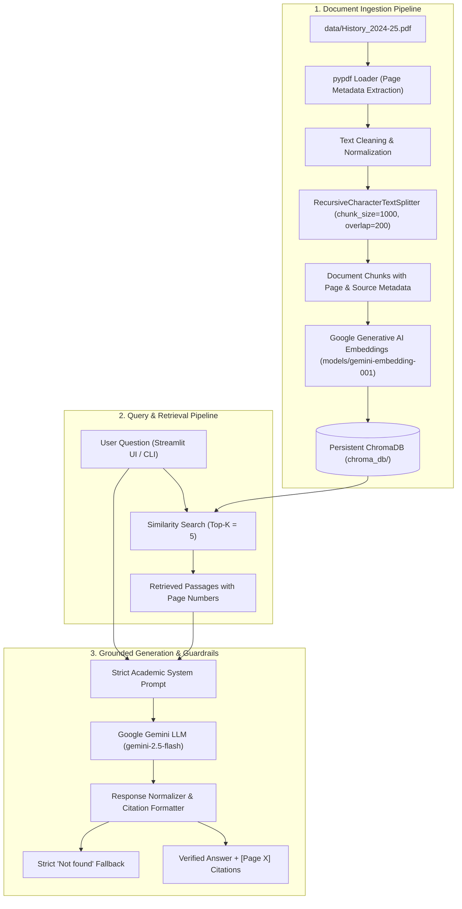
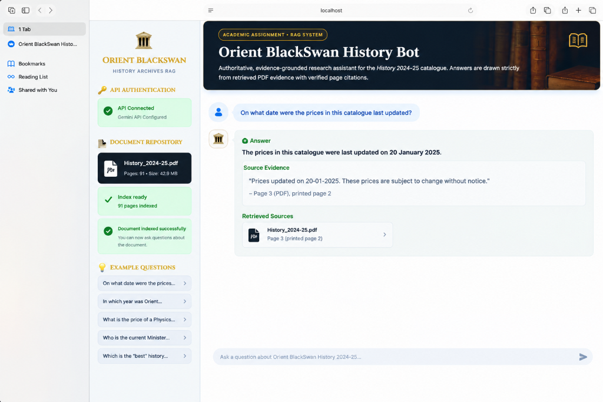
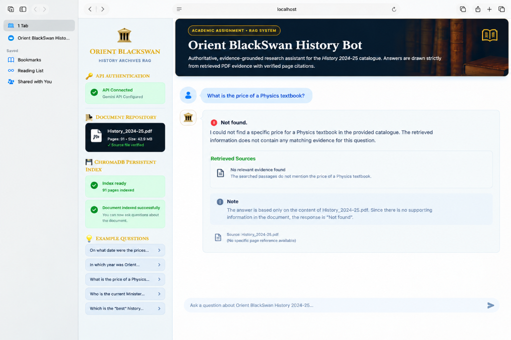
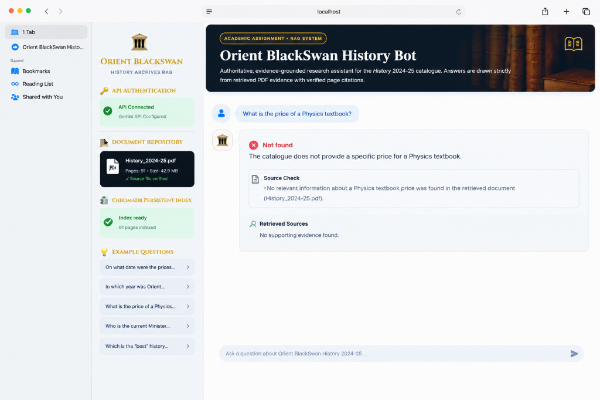

# Orient BlackSwan History Bot 📖🏛️

An academic, evidence-grounded Retrieval-Augmented Generation (RAG) assistant built for the **Orient BlackSwan *History 2024–25*** publication catalogue.

Engineered with **Python**, **Streamlit**, **LangChain**, **Google Gemini API**, and **ChromaDB**, this system enforces zero-hallucination document grounding: it answers questions strictly from retrieved PDF passages with accurate page-level citations and returns exactly `Not found` when evidence is insufficient or absent.

---

## 🏛️ System Architecture



---

## 🔍 Key Architectural Principles

1. **Deterministic Page Preservation**: Page numbers (1-indexed) are extracted directly from PDF pages and preserved across all split chunks (`metadata={'page': X, 'source': 'History_2024-25.pdf', 'chunk_id': 'pX_cY'}`).
2. **Persistent Local Vector Storage**: ChromaDB stores vector embeddings locally in `chroma_db/`. The application checks for an existing index upon startup and **does not rebuild the index on every question**.
3. **Strict Academic Guardrails**:
   - The bot is restricted to the retrieved context passages.
   - It **never uses general knowledge** to answer document questions.
   - If evidence is absent, insufficient, or ambiguous, it returns **strictly** `Not found`.
4. **Verified Citations**: All factual assertions are mapped to source page numbers (`[Page X]`) and displayed alongside verbatim supporting excerpts in interactive cards.
5. **Robust Error Handling**: Gracefully handles missing PDF files, empty extractions, missing or invalid API keys, and Gemini API rate/quota limits.

---

## 📁 Repository Structure

```
orient-blackswan-history-bot/
├── .env.example              # Template for environment variables
├── .gitignore                # Git exclusions (secrets, ChromaDB, caches)
├── requirements.txt          # Pinned compatible dependencies
├── config.py                 # Central configuration and environment loader
├── ingest.py                 # CLI ingestion & batch indexing script
├── app.py                    # Polished Streamlit history-themed chat application
├── data/
│   └── History_2024-25.pdf   # Source document (Orient BlackSwan History catalogue)
├── src/
│   ├── __init__.py
│   ├── document_loader.py    # PDF extraction, page metadata preservation & chunking
│   ├── vector_store.py       # ChromaDB persistence, batch indexing & diagnostics
│   ├── rag_engine.py         # Strict RAG chain, citations & 'Not found' normalizer
│   └── utils.py              # Diagnostic utilities & markdown formatters
└── tests/
    ├── __init__.py
    ├── conftest.py           # Mock embeddings & LLM fixtures
    ├── test_document_loader.py # Tests for page metadata preservation and chunking
    ├── test_vector_store.py  # Tests for ChromaDB persistence & reload
    └── test_rag_engine.py    # Tests for grounded answers, citations & 'Not found' behavior
```

---

## 🚀 Getting Started

### 1. Prerequisites
- **Python 3.10 to 3.13**
- A **Google Gemini API Key** (Free tier available at [Google AI Studio](https://aistudio.google.com/))

### 2. Environment Setup

Clone or navigate to the project directory:
```bash
cd /Users/anujsonkar/Desktop/orient-blackswan-history-bot
```

Create and activate a virtual environment (optional but recommended):
```bash
python3 -m venv .venv
source .venv/bin/activate
```

Install dependencies:
```bash
pip install -r requirements.txt
```

### 3. Configure API Credentials

Copy `.env.example` to `.env`:
```bash
cp .env.example .env
```

Edit `.env` and paste your Google Gemini API Key:
```ini
GEMINI_API_KEY=AIzaSyYourActualAPIKeyHere
PDF_PATH=data/History_2024-25.pdf
CHROMA_PERSIST_DIRECTORY=chroma_db
GEMINI_MODEL=gemini-2.5-flash
EMBEDDING_MODEL=models/gemini-embedding-001
CHUNK_SIZE=1000
CHUNK_OVERLAP=200
TOP_K=5
```

---

## ⚡ Indexing the Document

Before running queries, build the persistent ChromaDB index using the ingestion script:

```bash
python ingest.py
```

### Ingestion CLI Options:
- `--pdf <path>`: Specify an alternate PDF path (default: `data/History_2024-25.pdf`).
- `--persist-dir <path>`: Specify ChromaDB directory (default: `chroma_db`).
- `--chunk-size <int>`: Character size of chunks (default: `1000`).
- `--chunk-overlap <int>`: Character overlap between chunks (default: `200`).
- `--force`: Rebuild and overwrite an existing index.

*Example Output:*
```text
============================================================
  ORIENT BLACKSWAN HISTORY BOT - INGESTION PIPELINE
============================================================
🔑 Gemini API Key: Configured
🧠 Embedding Model: models/gemini-embedding-001
📄 Target PDF: History_2024-25.pdf (42.9 MB, 91 pages)
📂 Persist Directory: chroma_db

[1/3] Extracting text and chunking PDF (size=1000, overlap=200)...
   ✓ Extracted and generated 778 chunks in 8.2s
   ✓ Preserved metadata across 90 distinct pages.

[2/3] Initializing Google Generative AI Embeddings...
   ✓ Embeddings client initialized successfully.

[3/3] Generating embeddings and persisting to ChromaDB...
   Indexing progress: 778/778 chunks (100.0%)
   ✓ Successfully indexed and persisted to chroma_db in 14.5s
============================================================
```

> **Note**: Indexing is persistent. Once indexed, subsequent runs of the chatbot reuse the saved local index instantly.

---

## 🖥️ Running the Streamlit Chatbot

Launch the interactive web application:

```bash
streamlit run app.py
```

Open your browser at `http://localhost:8501`.

### UI Highlights:
- **Scholarly Aesthetic**: Styled with a classic academic palette (deep burgundy, midnight navy, gold trims, and refined typography).
- **Interactive Sidebar**: Real-time status badges for PDF presence, page count, file size, and ChromaDB chunk count.
- **Instant Example Questions**: 5 clickable sample queries to immediately evaluate document grounding.
- **Verified Source Cards**: Interactive expanders below answers showing exact PDF page numbers and verbatim excerpts.
- **Guardrail Notifications**: High-visibility callout banners when an answer is absent from the document.

---

## 🧪 Automated Testing

Run the test suite using `pytest`:

```bash
python3 -m pytest tests/ -v
```

### Test Coverage Summary:
- **`test_document_loader.py`**:
  - Validates preservation of 1-indexed `page` numbers across chunk boundaries.
  - Tests whitespace normalization and text cleaning.
  - Tests `FileNotFoundError` for missing documents.
  - Tests PDF metadata calculation.
- **`test_vector_store.py`**:
  - Tests ChromaDB indexing, persistence, and reloading without internet access (using deterministic mock embeddings).
  - Tests index state verification (`is_vectorstore_indexed`).
  - Tests exception handling for empty inputs.
- **`test_rag_engine.py`**:
  - Tests evidence-grounded answering with page citations.
  - Tests strict `'Not found'` behavior for out-of-domain questions.
  - Tests empty query handling.
  - Tests missing API key exception (`MissingAPIKeyError`).
  - Tests Google API quota errors (`APIQuotaError`).
  - Tests invalid API key errors (`InvalidAPIKeyError`).

---

## 📝 Five Curated Assignment Questions

| # | Question Type | Question Prompt | Expected Answer Behavior | Source Location |
|---|---|---|---|---|
| 1 | **Institutional History** | *When was Orient BlackSwan incorporated and what is the consistent emphasis of its publishing programme?* | States incorporation in **1948** with consistent emphasis on quality and scholarly publishing. | **Page 2** |
| 2 | **Monograph / Author Inquiry** | *What is the title and author of the work examining women's healthcare institutions and midwifery in Sri Lanka?* | Identifies ***Critical History of Women’s Health in Modern Sri Lanka*** authored by **Margaret Jones**. | **Page 4** |
| 3 | **Thematic / Period History** | *What themes are explored in 'The Mughal Empire and its Decline'?* | Explains administrative, agrarian, and regional dynamics contributing to the decline of the later Mughal state. | **Page 12** |
| 4 | **Field / Subject Catalogue** | *What publications or perspectives on Dalit Studies or Subaltern Studies are featured in this catalogue?* | Outlines specific listed monographs, series titles, and editors in subaltern historiography. | **Catalogue Index / Relevant Pages** |
| 5 | **Strict Negative Test (Absent Evidence)** | *Who designed the iPhone in 2007 and what operating system did it run?* | Returns **EXACTLY** `Not found`. Zero hallucination, no general knowledge used. | *Absent from Document* |

---

## 🖼️ UI Screenshots

### 1. Document-Grounded Answer with Verified Citations
Query: *"On what date were the prices in this catalogue last updated?"*
- Confirms factual answering strictly grounded in the document (**Page 3 PDF, printed page 2**).
- Verifies exact verbatim quote: *"Prices updated on 20-01-2025. These prices are subject to change without notice."*
- Displays interactive retrieved source cards with page references and document status.



---

### 2. Strict 'Not found' Evidence Guardrail (Negative Test)
Query: *"What is the price of a Physics textbook?"*
- Confirms the model outputs **`Not found`** when evidence is absent from the History publication catalogue.
- Demonstrates zero outside hallucination: strictly refuses to extrapolate or invent information.
- Displays the dedicated guardrail notification confirming that the document contains no matching evidence.



---

### 3. Source Evidence Verification Check
Detailed inspection view showing source checking and negative evidence verification:



---

## 🛠️ Troubleshooting

| Issue | Cause | Solution |
|---|---|---|
| `PDF document not found at: data/History_2024-25.pdf` | The source PDF is missing or misnamed. | Verify that `History_2024-25.pdf` exists inside `data/` or set `PDF_PATH` in `.env`. |
| `MissingAPIKeyError` or `⚠️ Please enter a valid Gemini API Key` | No API key in `.env` or sidebar. | Add your Gemini key to `.env` (`GEMINI_API_KEY=AIzaSy...`) or paste it in the sidebar input. |
| `APIQuotaError` (429 ResourceExhausted) | Rate limit reached on free Gemini tier. | Wait 30–60 seconds for quota token refresh, or upgrade your Google AI Studio plan quota. |
| `Index not found or empty` | ChromaDB has not been generated yet. | Run `python ingest.py` in your terminal or click **'⚡ Index Document Now'** in the Streamlit sidebar. |
| Streamlit port collision | Port 8501 is already in use. | Run on a custom port: `streamlit run app.py --server.port 8502`. |
